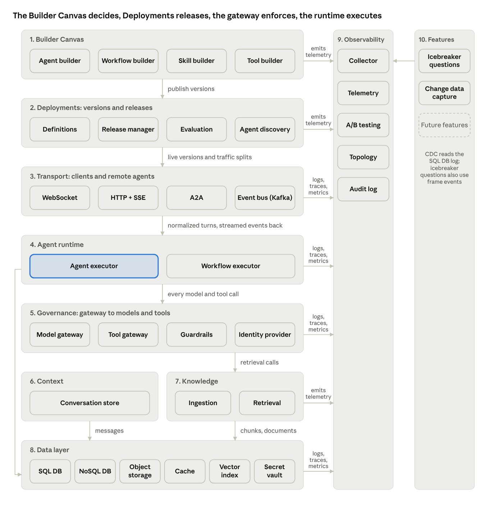

# Agent Platform System Design

The agent platform is nine subsystems on a shared data layer. Models and agents make decisions; the platform makes guarantees. Each subsystem below is described with the same template, so their boundaries and contracts can be compared directly.

The Builder Canvas publishes versions to Deployments, which picks the version that serves each request, and syncs policy to the transport, runtime and gateway. Clients and remote agents reach the runtime through the transport layer (WebSocket, HTTP with SSE and A2A for interactive use, Kafka for background agents). Every model and tool call leaves the runtime through the gateway, including retrieval from the knowledge layer. The runtime and the context layer write to the data layer, and every subsystem, including the Builder Canvas, emits telemetry to observability.

| Subsystem | Owns | Never does |
| --- | --- | --- |
| 1. Builder Canvas | Agent, workflow, skill and tool builders, entitlements, approvals | Enforce at runtime; decide which version is live |
| 2. Deployments | Versioned definitions, environments, releases (promotion, canary, A/B, rollback), evaluation gates, agent discovery | Edit definitions |
| 3. Transport | WebSocket, HTTP with SSE, A2A and Kafka endpoints; session binding; event delivery; version routing | Route turns or make decisions |
| 4. Agent runtime | Turn routing, frames, delegation, durable execution, per-turn working set, summarization | Interpret messages itself; authorize calls |
| 5. Governance and security | Identity, enforcement, guardrails, credentials, delegation policy, audit writes | Decide policy |
| 6. Context | Conversation history, with its retention and erasure | Build context; store frames |
| 7. Knowledge | Document ingestion, permission-aware indexes, retrieval | Answer questions itself; widen a user's access to sources |
| 8. Data layer and cross-cutting | SQL DB, NoSQL DB, object storage, cache, vector index, secret vault; shared identifiers and events | Hold business logic |
| 9. Observability | Traces, metrics, logs, A/B testing, topology, audit log | Decide what ships |
| 10. Features | Change data capture, Icebreaker questions and future user-facing capabilities built on platform data | Change how agents run |

**Principles.** Decisions in the model, guarantees in the platform. A dumb runtime. Builders own their design quality. Irreversible actions only in deterministic code. One store of record per fact. Enforcement where it cannot be bypassed. Open building inside a tenant. Outcomes observed, not only health.

**Template.** Each subsystem section covers responsibility, components, data model, key flows, interfaces and guarantees.

## Capability map

The same platform grouped by lifecycle stage, the way a product console shows it. Each row points to the subsystems that deliver it.

| Stage | What people do | Subsystems |
| --- | --- | --- |
| Build | Create agents, workflows, skills and tools; attach knowledge sources | Builder Canvas, Knowledge |
| Ship | Evaluate, release to dev and prod, canary and A/B, roll back, find deployed agents | Deployments |
| Run | Serve chat, A2A and background turns; run durable workflows; keep conversations; retrieve documents | Transport, agent runtime, context, Knowledge |
| Govern | Identity, budgets, guardrails, model and tool gateways, secrets, policy | Governance and security, Builder Canvas |
| Observe | Traces, metrics, logs, A/B testing, topology, audit log | Observability |
| Improve | Turn friction and failures into eval cases; measure features | Observability, Deployments, Features |
